# MediPay: technical GRC and supply chain risk portfolio

> **A personal learning project, not work experience.** MediPay is a **fictional** UK healthcare billing company. All data is synthetic, and all sources are public. Parts of this repo were drafted with AI help. See [what AI did and what I checked](docs/portfolio.md#how-ai-was-used).

**Who I am:** a graduate moving into **technical GRC and third-party risk (TPRM)**, with about 2 years in DAST scanning and incident response.

**The idea:** I can assess a supplier's security better because I've built and tested the same controls myself.

## Two strands, one story

| 🔧 Technical controls (what good looks like) | 📋 TPRM programme (how to ask for it) |
|---|---|
| A small patient-records API, hardened and run through **10 CI gates** before a signed release | [Supplier inventory and tiering](grc/tprm/a-supplier-inventory.md), [due diligence questionnaire](grc/tprm/b-due-diligence-questionnaire.md), [contract checklist](grc/tprm/c-contract-checklist.md) |
| Pinned and signed software supply chain (SBOM, Cosign) | [Continuous monitoring](grc/tprm/d-continuous-monitoring.md), [breach response and exit plan](grc/tprm/e-response-and-exit.md) |
| Kubernetes and Terraform policies as code | [Board brief](grc/tprm/f-board-brief.md), [mapping to the UK Pledge and the CS&R Bill](grc/tprm/g-mapping.md) |

Start with the **[executive summary](docs/executive-summary.md)** (2 pages).

## Architecture

```mermaid
flowchart LR
    dev[Developer PR] --> gh[GitHub]
    subgraph ci[CI: every PR must pass]
      direction TB
      g1[lint and tests incl. security regression tests]
      g2[secrets: Gitleaks]
      g3[SAST: Bandit, Semgrep]
      g4[SCA: pip-audit, hash-pinned deps]
      g5[image-scan: Trivy image and config]
      g6[sbom: Syft]
      g7[k8s-policy: Kyverno tests]
      g8[iac: Checkov and Conftest]
      g9[dast: OWASP ZAP]
    end
    gh --> ci
    ci -->|main only| pub[publish: push to GHCR, Cosign keyless sign and SBOM attestation]
    pub --> k8s[Kubernetes: Kyverno blocks root, untrusted or unsigned images]
    tf[Terraform: evidence bucket and AWS baseline] -.scanned, not deployed.-> aws[(AWS eu-west-2)]
```



## Controls and evidence

Every control has a **control card** in [`grc/controls.md`](grc/controls.md): the risk, the evidence (PRs and CI runs), known gaps and an interview line. Every gate was **seen to fail** before it was trusted.

| Day | Control | Proven by |
|---|---|---|
| 1 | Non-root container, image scanning gate | Test PR #13: removing `USER` blocked the merge (DS-0002) |
| 2 | SHA, digest and hash pinning. SBOM. Keyless signing | pip-audit caught a new CVE. Trivy blocked when base image fixes appeared |
| 3 | Kyverno admission policies (non-root, our registry, digest, signature) | Policy tests: bad manifests must fail |
| 4 | Terraform scanning: Checkov plus our own Rego rules (UK region only, data classification) | A broken-on-purpose example must fail |
| 5–6 | AWS baseline as code: GitHub OIDC (no stored keys), CloudTrail, guard rails | Checkov 131 passed, 0 failed |
| 7 | ZAP API scan gate and STRIDE threat model | ZAP found missing headers, fixed with regression tests |

## Repo map

| Path | What |
|---|---|
| `app/`, `test_*.py` | The Patients API (🛠️ "dev team" code) and its tests |
| `.github/workflows/ci.yml` | All the gates |
| `k8s/`, `policies/kyverno/` | Kubernetes manifests and admission policies |
| `terraform/`, `policies/conftest/` | Infrastructure as code and our Rego rules |
| `docs/` | [Threat model](docs/threat-model.md), [executive summary](docs/executive-summary.md), [portfolio and AI note](docs/portfolio.md), [STAR stories](docs/star-stories.md), [LinkedIn draft](docs/linkedin-post.md) |
| `grc/` | [Control cards](grc/controls.md), [decision log](grc/decision-log.md), [UK context](grc/phase1-context.md), [scenario](grc/scenario.md), [TPRM deliverables](grc/tprm/) |

## Run it locally

```bash
python3 -m venv .venv && source .venv/bin/activate
pip install --require-hashes -r requirements-dev.txt
pytest                                   # 9 tests, including security regression tests
docker build -t medipay . && docker run -p 8000:8000 medipay
curl localhost:8000/health               # {"status":"ok"}
pre-commit install                       # Gitleaks hook on every commit
```

## Known gaps (accepted for synthetic data only)

No authentication, sequential IDs, no per-user audit log, in-memory storage, and no live AWS account. See the [threat model](docs/threat-model.md) and the control cards.
